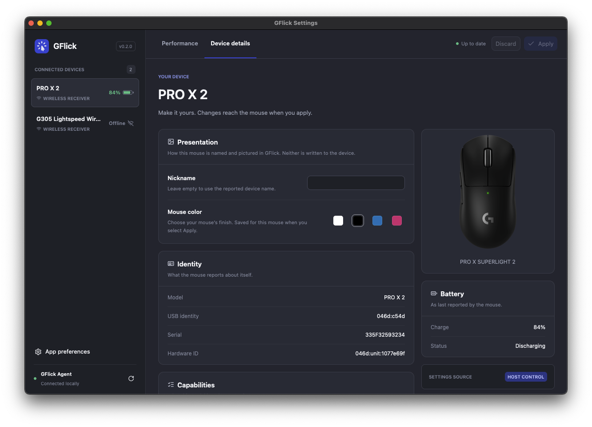
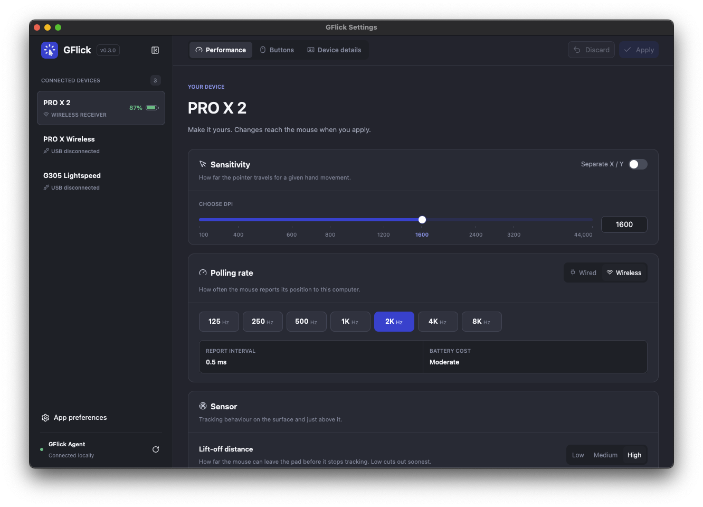

I have a Logitech mouse, and that means I also have Logitech G HUB. I never wanted G HUB. I wanted to change my DPI and polling rate, and G HUB is the only official way to do it.

**gflick** is what happened after I got tired of that. It is an open source, Rust-based tool that talks directly to compatible Logitech mice and lets you change their settings without G HUB. It is also my first Rust project, my first time using GPUI, and, to be completely honest, a project that is not in a great state right now.

This post is the story of how it started, what I learned building it, and where it stands.

## The problem with G HUB

G HUB is slow. Opening it to change one value means waiting for a large app to start, load its profiles, find the device, and finally render the screen I need. It feels a lot more like opening a game launcher than a settings panel.

Being slow, though, is something I could live with. What finally pushed me was that G HUB broke on me after an update, and not just once. A few times, an update left the app stuck or unable to see the mouse, and I could not change my settings until I reinstalled it or waited for a fix. The mouse was fine. The software I had to use to configure it was not.

That is a frustrating position to be in. The hardware already stores most of its configuration on board, and changing a DPI value is ultimately a few bytes sent over USB. Everything between me and those bytes was the part that kept failing.

So I started wondering how hard it would be to send those bytes myself.

## Something new on purpose

I could have built this in TypeScript. Most of my projects are web projects, and there are ways to talk to HID devices from Node or even from the browser.

I chose not to. I wanted to experiment with something I had never used, and **Rust** had been on my list for a long time. A small background program that talks to hardware, needs to stay out of the way, and should use almost no memory felt like exactly the kind of problem Rust was designed for.

I had also already written about [Zed](/blog/zed-editor) and why a native editor built from scratch in Rust felt so different from Electron apps. Zed's UI framework, **GPUI**, was the obvious thing to try for the desktop part. I had no experience with either of them, and that was the point.

## Learning to speak HID++

Logitech mice use a protocol called **HID++** on top of standard HID. Every feature (battery, DPI, polling rate, lighting, onboard profiles) is identified by a feature ID, and the mouse tells you which features it supports. If the mouse doesn't advertise a feature, gflick doesn't show the control for it.

I started with a single diagnostic CLI that opened the mouse, listed its features, and printed whatever I could decode. A lot of the early work was reading bytes, comparing them with what I expected, and slowly turning them into real types. Rust was very good for this kind of work. Once a response was parsed into a proper struct or enum, the compiler made it very hard to forget a case or use a value that hadn't been validated.

It was also the first time I wrote code where a mistake could do more than crash a page. Writing settings to a device's firmware deserves respect, so gflick is defensive: it rejects unsupported values, reads every setting back after writing it, and the onboard profile writer preserves unknown bytes, regenerates CRCs, and rolls back if anything doesn't match. Hidden manufacturing, reset, and firmware update features are intentionally blocked.

So far, the tested mice are the **PRO X Superlight**, the **PRO X Superlight 2**, and the **G305**, on Windows and Apple Silicon macOS.

## From a script to a workspace

The project began on August 2 under the name "Open Hub". Three days later it was renamed gflick, and it quickly grew from one CLI into a full Cargo workspace:

- **gflick-core**: the HID++ transport, device discovery, capabilities, settings, and onboard profile APIs.
- **gflick-agent**: a small background process that owns the mouse, monitors the battery, saves preferences, and serves a local IPC protocol.
- **gflick**: a scriptable CLI that talks to the agent.
- **gflick-tray**: a native tray and menu bar app showing battery and DPI.
- **gflick-settings**: the experimental desktop app built with GPUI.
- **gflick-probe**, **gflick-bench**, and **gflick-setup**: tools for diagnostics, benchmarking, and installation.

The important decision was the agent. Only one process should own the HID connection, so every other app talks to the agent over a local socket instead of talking to the mouse directly. The tray, the CLI, and the settings window are all just clients. This is the kind of architecture I would normally build with a server and a few frontends on the web. Building it with OS-local sockets and threads instead of HTTP and a database was a big part of what made the project fun.

## Was it actually lighter?

The whole reason for the project was that G HUB felt heavy, so I wanted to measure it instead of guessing. I built a small benchmarking tool that samples OS process counters and ran a 30-minute idle comparison on Windows.

| Metric                 |   gflick |      G HUB |
| ---------------------- | -------: | ---------: |
| Average CPU (one core) |   0.105% |     0.385% |
| Resident memory        | 7.58 MiB | 227.55 MiB |
| I/O read               |   ~24 KB |     ~20 MB |

That is **72.8% less CPU** and **96.7% less memory** for the background process. It is an early result. Both stacks were running at the same time and I only recorded a single run, so it's not a rigorous benchmark. But it was the first moment the project felt like more than an experiment. A Rust agent that sits at under 8 MiB of memory was exactly what I had hoped for.

## Meeting GPUI

The tray app and the CLI covered the basics, but a real G HUB alternative needs a proper settings window. That is where GPUI came in.

GPUI is the GPU-accelerated UI framework built by the Zed team. You describe the interface in Rust with an API that feels surprisingly close to writing Tailwind classes: `div().flex().gap_2().p_4()`, and so on. Coming from React, that part was immediately familiar. Everything else was not.

There is no DOM and no CSS file, and state does not work the way it does in React. You work with entities, contexts, and the borrow checker at the same time, and the first few days were mostly me fighting the compiler over who owns what. GPUI also moved fast while I was using it, and it originally lived inside the Zed repository, so I ended up using **GPUI Kit**, which packages GPUI and its component library into a single released crate.

The first version of the settings window, from September 10, was simple: a list of connected mice, a device details page, and the Apply and Discard buttons that every change goes through.

One lesson surprised me: debug builds felt slow. Layout, text shaping, and image decoding are only fast once they're optimized, so the window dropped frames in development and was perfectly smooth in release. The fix was compiling dependencies with optimizations while keeping the project itself at `opt-level = 0`, which kept rebuilds quick and the window smooth.

By mid-September, the settings app had a device sidebar with product images, DPI sliders with linked X and Y axes, polling rate and performance controls, button mapping, a confirmation dialog before applying changes, keyboard shortcuts, and an FPS overlay that I mostly added because I was curious.

It was the most fun part of the whole project, and it's still the least finished.

## Where it is today

The last commit is from September 18. Since then, I simply haven't had much time to give to gflick.

The core library, the agent, the CLI, and the tray work, and there are experimental, unsigned releases for Windows and Apple Silicon macOS. But the settings app, the part most people would actually want, is not shipped in the release bundles yet. Hardware support is limited to the three mice I could test, and the installer and benchmarks still need a lot more validation before I could recommend it to anyone who isn't comfortable debugging.

And yes, at some point during all of this I also bought **gflick.app**. I am not completely sure why. It felt like the right thing to do in the middle of a productive week, and now there is a small Astro landing page for a project that is not ready for a landing page. I am choosing to see it as a promise to my future self.

## What I learned

Even unfinished, gflick was worth it.

- Rust is much less scary when the project gives you a real reason to use it. Parsing bytes from hardware into strict types is exactly where it shines.
- GPUI is genuinely fast, but it asks you to think about UI in a very different way than the web does.
- Measuring the thing that annoys you is more convincing than complaining about it.
- Buying a domain does not make a project finished.

I don't know exactly when I will be able to come back to it. When I do, the first goal is simple: ship the settings app and make gflick something I can use every day instead of G HUB.

If you have a compatible Logitech mouse and are not afraid of experimental software, the code is on [GitHub](https://github.com/R4ULtv/gflick). Issues, test reports on other mice, and contributions are all very welcome.
