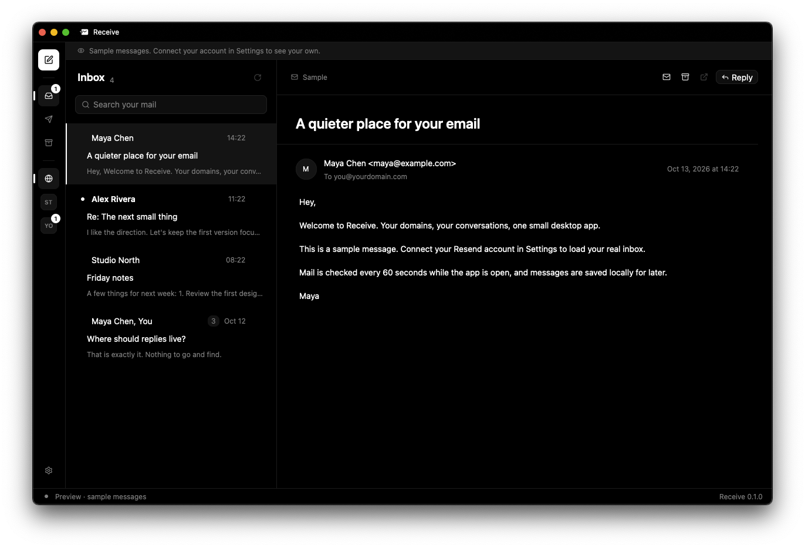

Right after [gflick](/blog/gflick), I did the same thing again: I found something missing from a tool I use every day, and I built a small Rust desktop app to fill the gap.

This time the tool is [Resend](https://resend.com). I have several domains on it, and Resend handles everything for them: sending, receiving, DNS, deliverability. What it doesn't have is a place where I can simply read that mail and answer it.

**Receive** is that place. It is a small, open source desktop app that turns a Resend account into an inbox. Like gflick, it is a side project that I haven't had much time for since I started it, but the basics are there and it works.

## The missing piece

Resend can receive email now. Mail sent to my domains arrives, it is stored, and I can see it in the dashboard and through the API. Sending is, of course, what Resend was built for.

The problem is everything in between. The dashboard is built for developers checking logs, not for someone reading a conversation. There is no thread view, no reply button, no compose window. If someone writes to one of my domains, I can see that they did, but answering them means switching to another tool or writing an API call.

Everything I needed was already managed by Resend. I didn't want another mail provider or to move my domains somewhere else. I just wanted an interface on top of what I already had.

## What Receive does

Receive connects directly to Resend. There is no server to set up and nothing in between: the app talks to the Resend API from your computer.

- Inbox and sent mail for every domain in one place, with a filter for each domain.
- Conversations, so my reply sits right below the message it answers.
- Compose and reply, with drafts saved as I type.
- Read and unread, plus a local Archive.
- Delivery updates for sent mail, such as delivered, delayed, or bounced.
- A local copy of downloaded messages that I can search.
- Automatic checks for new mail every 60 seconds while the app is open.

The layout is the one you would expect from any mail app: the domains on the left, the conversations in the middle, and the open message on the right. The screenshot is from preview mode, so every message in it is fake.

It is a small feature set, and it is built entirely around how I use my own domains. But that is exactly what I was missing.

## Same stack, different problem

After gflick, choosing the stack was easy. Receive is written in **Rust** with **GPUI Kit**, the packaged version of the UI framework from Zed, and it uses Resend's official [resend-rs](https://resend.com/docs/send-with-rust) SDK.

The second time around, GPUI felt much less foreign. I still fight the borrow checker sometimes, but I already knew how entities and contexts work, and I already knew the trick of optimizing dependencies in debug builds so the window doesn't stutter. The whole first version was written in a single day, on September 21, something that would have been impossible a month earlier.

The app is split into a few simple parts:

- **api**: a thin layer over resend-rs that lists, reads, and sends mail, and turns Resend's types into the app's own.
- **worker**: a background thread that owns the connection, syncs both folders page by page, and backs off when Resend returns errors.
- **store**: a local SQLite database with the downloaded messages, drafts, settings, and read state.
- **thread**: the code that groups messages into conversations.
- **ui**: the sidebar, the mail view, the compose window, and settings.

Like gflick's agent, the worker is the only part that talks to the outside world. The UI just sends it requests and listens for events, so a slow network call never blocks the window.

## Signing in

There are two ways to connect an account. The simple one is pasting a **Full access** API key. The nicer one is signing in through the browser: Receive registers itself with Resend's OAuth, opens the authorization page, and waits for the redirect on a temporary local port, using PKCE so no secret has to live inside the app.

Either way, the credentials go into the operating system's credential store, the macOS Keychain or the Windows Credential Manager, and never into the app's own files or logs.

## Threading is harder than it looks

The part that took the most thought was grouping messages into conversations.

Email has a proper way to do this. Every message carries a `Message-ID`, and replies point back to the messages they answer with the `In-Reply-To` and `References` headers. Receive links any two messages that share an identifier, even if one is in the inbox and the other is in sent mail.

The catch is that Resend only returns those headers for **received** mail. For mail I sent, they're simply not there. So Receive records the headers itself when a reply goes out, and keeps them locally.

Mail sent before that existed still has nothing to link on, so it falls back to matching on the subject, but only when the same people are involved. Without that guard, a monthly email called "Invoice" to a single supplier would collapse a whole year of separate conversations into one giant thread. Messages that are already linked by their headers are never merged on subject alone.

It is not perfect, but it is good enough that my conversations look like conversations.

## Local by design

Resend doesn't keep received mail forever, so Receive downloads every message into a local SQLite archive. That's also what makes search and the Archive view possible.

Archiving is Receive's own concept and happens only on my computer. Nothing is deleted from Resend, and checking for mail never pulls an archived conversation back into the inbox. Drafts and read status are local too, so they don't sync between my Mac and my Windows PC. For one person with a handful of domains, that's fine.

## Where it is today

The last commit is from the same day the project started. Since then, like gflick, it has mostly been sitting there.

It works. I can read mail from all my domains, reply, start new conversations, and see whether they were delivered. But there are plenty of rough edges:

- Emails are displayed as plain text. HTML mail is converted, and anything more complex means opening it in the Resend dashboard.
- Attachment names are shown, but sending and downloading attachments isn't supported yet.
- Large mailboxes may be slow, and only one Resend account can be connected at a time.
- The app has to be open to check for mail, and anything that expires on Resend before Receive downloads it is gone.
- There are no prebuilt downloads. You need Rust installed and have to run `cargo run` yourself.

If you just want to look around, `cargo run -- --preview` opens the app with sample messages, without connecting an account.

## What I learned

- The second project with a new stack is where it starts to pay off. Most of what was hard in gflick was simply not hard anymore.
- A great API doesn't make an interface unnecessary. Resend has all the data I need; it just doesn't need to show it the way I want to read it.
- Email standards are old, but they're there for a reason. Threading on real headers, and only falling back carefully, makes all the difference.
- Small tools for yourself don't need to be finished to be useful.

I don't know when I'll come back to it. When I do, attachments and HTML rendering are first on the list.

If you use Resend for receiving email and want a simple place to read it, the code is on [GitHub](https://github.com/R4ULtv/receive). Issues and contributions are very welcome.
