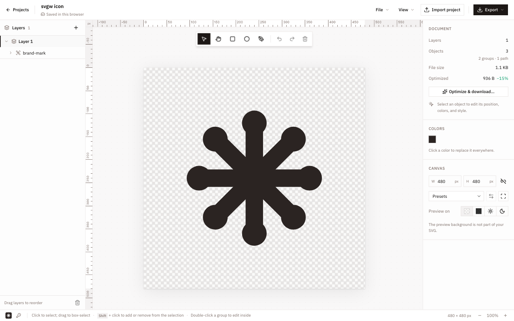

After two Rust desktop apps in a row, [gflick](/blog/gflick) and [Receive](/blog/receive), this time I went back to the web. The reason is simple: the problem I wanted to solve was about not being tied to one computer.

I work with a lot of SVGs. Icons, logos, small illustrations, assets for my websites. Most of the time the changes are tiny: a color, a size, a stroke, removing a layer I don't need. But every one of those changes meant opening a dedicated design app, and I don't have that app on every device I use.

**svgw** is my answer to that. It is a free, open source SVG workspace that runs in the browser. I can open it anywhere, edit my files, and, on my own instance, save them online in a Cloudflare R2 bucket so they are waiting for me on the next device.

## The problem

Desktop design software is great when you sit at the computer where it's installed. The moment you switch to a laptop, a work machine, or a computer that isn't yours, the files and the tool both stay behind.

For big design work, that's acceptable. For "change this icon from black to green and export it again", it isn't. I wanted three things:

- An editor that opens in any browser, with nothing to install.
- A place where my SVGs live, so I don't have to move files around between devices.
- Exports that are clean enough to drop straight into a website.

There are online SVG editors, but they either want an account on someone else's service or they forget everything the moment you close the tab. I wanted my files in my own storage.

## What svgw does

The editor covers the things I actually do with SVGs:

- Draw with rectangles, ellipses, and the pen tool, with undo and redo.
- Nested layers with visibility, locking, renaming, and drag-and-drop reordering.
- Fill, stroke, and opacity, with HEX, RGB, HSL, and OKLCH color inputs.
- A document color list: click a color to replace it everywhere in the file.
- Position, size, rotation, alignment, and distribution for the selection.
- Rulers, guides, snapping, and resizing the artboard to fit the artwork.
- Import SVG files, or add them as a new layer in an existing project.
- Export a standard SVG or an optimized one, with the size difference shown before downloading.

The layout is the classic one: layers on the left, canvas in the middle, inspector on the right. The inspector changes with the selection. With nothing selected, it shows the document itself: how many objects it contains, how big the file is, and how much smaller it would be after optimization.

## Two ways to use it

The public website at [svgw.raulcarini.dev](https://svgw.raulcarini.dev) is free and needs no account. Everything stays in your browser: drafts are saved in IndexedDB one second after you stop editing, and you can download a portable `.json` project or the SVG whenever you want.

The online part is for self-hosted instances. Run svgw on your own Cloudflare account, and you get online drafts, version history, and public project links, all stored in your own R2 bucket. That's how I use it: my instance is where my SVGs live, and the same projects are there from every device I log in from.

I liked this split. The website is useful to anyone, and I never have to store anyone else's files. If you want online saving, you bring your own storage.

## The stack

svgw is built with **React**, **TypeScript**, and **TanStack Start**, which I already used when [rewriting Rail Radar](/blog/rewriting-rail-radar-with-tanstack-start). Here it runs in SPA mode: there's nothing to render on the server, just a static app shell and the editor routes.

The hard part of an SVG editor is the editor itself, so I didn't write that from scratch. The document and the edit history are managed by **SVG-Edit's** `svgcanvas` package, and svgw wraps it with its own React interface: the toolbar, layers, inspector, guides, commands, and keyboard shortcuts. The UI uses Tailwind CSS and shadcn/ui, and colors go through culori, which is what makes the OKLCH inputs possible.

Two smaller pieces matter a lot:

- **DOMPurify** sanitizes every imported SVG. An SVG is a document that can contain scripts and event handlers, and opening a file in an editor should never mean running code from it.
- **SVGO** runs in a Web Worker for optimized exports, so optimizing a large file never freezes the editor.

SVGO is configured carefully. Some of its default optimizations, like merging paths, collapsing groups, or rewriting IDs, make files smaller but also harder to edit later. svgw disables those, so an optimized file still has the same layers and structure as the one you designed.

## One Worker, one bucket

The whole backend is a single **Cloudflare Worker** with a private **R2 bucket**. The Worker serves the static app and a small `/api`. There's no database and no scheduled job.

Each project is stored as two kinds of objects:

- A manifest at `projects/<id>.json` with the name, visibility, list of versions, and which version is published.
- One snapshot per version at `versions/<id>/<version>.json`.

Saving a project writes a new snapshot and updates the manifest. After each save, the Worker cleans up older versions in the background: the latest 100 are kept, together with anything pinned or published.

The interesting part is conflicts. If I leave the editor open on my laptop and then edit the same project on my desktop, the two can't silently overwrite each other. Every manifest update is a conditional write using the object's ETag: R2 only accepts it if the manifest hasn't changed since the editor last read it. If it has, autosave pauses and svgw offers to reload the saved version, keeping my local edits as a separate backup instead of throwing them away.

It's a small detail, but it's exactly the situation I built svgw for: the same files, edited from different devices.

## Saving, versions, and publishing

Online drafts autosave every 30 seconds while the editor is open, and `Cmd/Ctrl+S` saves immediately. If an upload fails, the local draft stays and svgw retries.

Every save is a version. From the version history I can restore an older one, which creates a new draft instead of rewriting history, or pin it so it's never cleaned up.

Publishing makes one specific snapshot public at `/project/<id>`. Later edits remain private drafts until I publish again, so I can keep working on a public project without anyone seeing half-finished changes. Visitors who open a published project can edit it too, but only as their own local copy: the original doesn't change.

The bucket itself stays private. All access goes through the Worker, which checks whether a project is public before returning it. Making the bucket public would skip those checks entirely, and the README says so clearly.

## No accounts

svgw has no users. A self-hosted instance has exactly one admin key, stored as a Worker secret, with access to every online project.

When I log in with it, the Worker returns a session token signed with HMAC-SHA256, using the admin key itself as the signing key. The token lasts seven days and stays in `localStorage`, so I'm logged in across tabs and browser restarts, but the key itself is never saved in the browser. Rotating the key invalidates every session at once.

For a personal tool, that's all I need. Building accounts, passwords, and permissions would have taken longer than the editor.

## Two days

The first commit is from October 11 in the afternoon. By that evening, there was a working editor, a Cloudflare deployment, and a projects page for local and remote SVGs. On October 12, I added portable project import and export, the inspector controls for position, alignment, text, strokes, and document colors, and finally cloud sync and version history in the projects page.

Coming from GPUI, the speed was the most noticeable thing. On the web, I already know how everything works, and building on top of an existing editor engine meant I could spend my time on the parts I actually cared about: the workflow, the storage, and the details.

## What it doesn't do (yet)

svgw is very new, and it has clear limits:

- Local drafts belong to one browser on one site. Without a self-hosted instance, download a project file if you want a backup.
- There is one admin per instance. No multiple users, no shared editing.
- Online projects are limited to 8 MiB.
- Affinity files can be converted with a local script in the repository, but that's a development tool, not something the website can do. For Illustrator, you still need to export an SVG from the desktop app first.
- The editing tools are the basics. It's built for editing SVGs, not for replacing a full design app.

## What I learned

- Not every side project needs a new stack. Going back to what I know made svgw take two days instead of two months.
- Building on a solid engine is a good trade. SVG-Edit handles the document and history, so I could focus on everything around it.
- Object storage can go a long way without a database. A manifest, snapshots, and conditional writes are enough for versions and conflict detection.
- The best version of "sync" for a personal tool is storage I own and can deploy in one command.

Now when I need to change an icon, I just open a browser tab.

You can try svgw at [svgw.raulcarini.dev](https://svgw.raulcarini.dev), and the code, with a full guide to hosting your own instance, is on [GitHub](https://github.com/R4ULtv/svgw). Issues and contributions are very welcome.
